<p align="center">
  
</p>

<p align="center">
  <a href="https://github.com/netspeedy/zquota/releases"></a>
  <a href="LICENSE"></a>
  <a href="https://github.com/netspeedy/homebrew-zquota"></a>
  <a href="https://github.com/netspeedy/zquota"></a>
  <a href="https://buymeacoffee.com/soakes"></a>
</p>

---

This is the Homebrew tap for [zquota](https://github.com/netspeedy/zquota). zquota shows how much of your Z.ai quota you've used and exactly when each window resets, including the five-hour rolling window that Z.ai's own charts make hard to read.

## Install

```bash
brew tap netspeedy/zquota
brew install zquota
```

The formula installs the single-file CLI on macOS and Linux and runs it on Homebrew's Python.

> On recent Homebrew, new third-party taps require explicit trust. If installation is refused, run `brew trust netspeedy/zquota` once, then `brew install zquota`.

## Try it

Set your API key and run it:

```bash
export ZAI_API_KEY='your-api-key'
zquota
```

You get your plan and a block for each quota window:

```text
  Z.ai plan: pro

  │  5-Hour Rolling Token Quota
  │
  │  [████████████░░░░░░░░░░░░] 50% used
  │  Remaining: 50%
  │  Limit:      1.0M
  │  Used:       500.0k
  │  Remaining:  500.0k
  │  Resets in:   30m
  │  Resets at:   2026-05-23 15:00:00 BST
  ──────────────────────────────────
```

`--compact` gives one line per quota, `--json` and `--jsonl` are there for scripts, `--watch 30` refreshes every 30 seconds, and `--threshold 80` exits with code 2 once any window reaches 80%. Reset times are shown in `Europe/London` unless you pass `--timezone` or set `ZAI_TIMEZONE`. The [usage guide](https://github.com/netspeedy/zquota/blob/main/docs/usage.md) has the rest.

## Upgrade or remove

```bash
brew upgrade zquota
brew uninstall zquota
brew untap netspeedy/zquota
```

## Available formulae

| Formula | Description |
|---|---|
| [`zquota`](Formula/zquota.rb) | Z.ai quota monitor with terminal and JSON output |

## About this tap

This repository only packages [`Formula/zquota.rb`](Formula/zquota.rb). The zquota release workflow rewrites it for each stable [release](https://github.com/netspeedy/zquota/releases); release candidates aren't published here. The signed APT repository, pip and the standalone script are described in the [main README](https://github.com/netspeedy/zquota#install). Please open issues in the [main repository](https://github.com/netspeedy/zquota/issues).

The banner at the top of this page and the repository's social preview image are generated. Edit the copy, layout or timing in `.github/scripts/build_readme_hero.py` and run it to rebuild `assets/zquota-readme-hero.svg` and `assets/zquota-social-card.png`; the card is uploaded by hand under Settings, since GitHub has no API for it. Run it with `uv run .github/scripts/build_readme_hero.py`, which installs the pinned fontTools it subsets the fonts with. The fonts come from assets.netspeedy.io, so the first run needs network access, and the card is rendered with headless Chrome or Chromium.

## License

Copyright © 2026 [Simon Oakes](https://github.com/soakes). Released under the [MIT License](LICENSE).

This tap only packages the [zquota](https://github.com/netspeedy/zquota) formula, an unofficial community tool that is not affiliated with, endorsed by, or sponsored by [Z.ai](https://z.ai).
